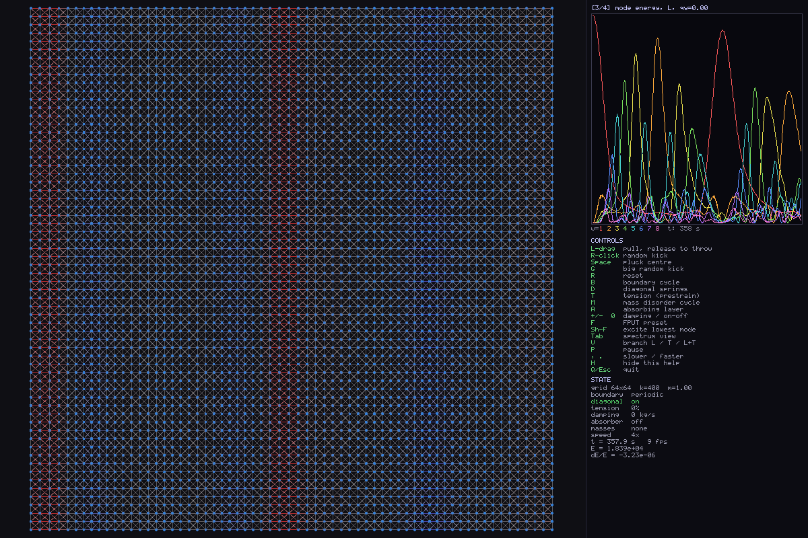

# spring_grid

A real-time 2-D spring-mass lattice in C17 with SDL2 and FFTW, with
spectral diagnostics that can be checked against the analytic dispersion
relation.

An N×M grid of point masses is connected by Hookean springs: cardinal
springs, plus optional diagonal (shear) springs. Either family can be made
of rigid rods instead. You can pull and throw
masses, switch boundary conditions, prestress the lattice, add mass defects
or disorder, and absorb outgoing waves at the edges. Four spectral views
show where the energy sits and how it moves: mode occupation, the ω–q
dispersion, the energy in each mode over time, and the total energy.



---

## Features

- **Lattice units.** Spacing a = 1, time in seconds. Pixels exist only in the renderer.
- **Integrator.** Split-damped velocity Verlet. The conservative part is symplectic.
  Drag is applied exactly, as v ← v·e^(−γΔt/2m), on each side of the Verlet step.
- **Fixed timestep.** Simulated time runs at `speed`× wall-clock time, whatever the
  monitor's refresh rate.
- **Four boundary conditions.** Free, pinned, clamped and periodic, each paired with the
  spectral basis that matches it.
- **Rigid rods.** Cardinal and/or diagonal bonds can be inextensible rods,
  enforced as constraints with RATTLE. They store no energy, show their load in
  colour, and do not limit Δt.
- **Prestress (tension).** Gives the cardinal-only lattice a nonzero transverse stiffness.
- **Disorder.** A light mass defect (which has a localised mode above the band), a heavy
  defect, or random masses.
- **Absorbing layer.** A graded drag layer at the edges.
- **Spectral views.** Occupation |v(q)|², a space-time FFT S(q, ω) with the analytic
  branches overlaid, FPUT-style mode energies, and KE/PE/E histories.
- **Polarisation split.** Spectra are projected onto the analytic quasi-L and quasi-T
  eigenvectors at each q.
- **FPUT preset.** Shows energy leaving the lowest mode and returning to it (98% at 32×32).
- **Energy readout.** Shows relative energy drift whenever the system is conservative
  and undisturbed.
- **Display.** Resizable window with HiDPI support, and batched `SDL_RenderGeometry`
  drawing.
- **Tests.** A headless test suite (`make test`) checks the physics and the spectra.

---

## Dependencies

| Platform | Command |
|---|---|
| macOS (Homebrew) | `brew install sdl2 fftw` |
| Debian / Ubuntu | `apt install libsdl2-dev libfftw3-dev` |
| Fedora | `dnf install SDL2-devel fftw-devel` |

You also need SDL ≥ 2.0.18 (for `SDL_RenderGeometry`), a C17 compiler, and `make`.
The tests need FFTW only, not SDL.

---

## Build

```sh
make          # optimised build             ->  ./spring_grid
make debug    # ASan + UBSan build          ->  ./spring_grid_debug
make test     # headless physics tests      ->  tests/test_sim
make install  # ~/.local/bin/spring_grid + ~/.local/share/man/man1/spring_grid.1
make uninstall
make clean
```

`make install PREFIX=/usr/local` installs system-wide (prefix it with `sudo`),
and `DESTDIR` works for staged installs. On both Linux and macOS, `man` finds
pages in `~/.local/share/man` automatically once `~/.local/bin` is on your
`PATH`. Then run `man spring_grid`.

---

## Running

```sh
./spring_grid                                   # 64x64, free edges, diagonals on
./spring_grid -c 32 -r 32 --bc periodic         # smaller torus
./spring_grid --bc clamped --no-diag --prestrain 0.05   # a drum: tension gives
                                                        # transverse stiffness
./spring_grid --disorder light --absorb         # localised mode survives the absorber
./spring_grid -c 32 -r 32 --rod-cardinal        # rigid rows/columns, diagonal springs
./spring_grid --rod-cardinal --dt 2e-3          # 64x64 with rods at ~real time
./spring_grid --help
```

| Option | Default | Meaning |
|---|---|---|
| `-c, --cols N` / `-r, --rows N` | 64 / 64 | grid size (4–1024; even for periodic) |
| `-m, --mass M` | 1.0 | node mass, kg |
| `-k, --k K` | 400 | cardinal spring constant, N per lattice unit |
| `--kdiag K` | = k | diagonal spring constant |
| `--no-diag` | | start with the diagonal springs off |
| `--rod-cardinal` / `--rod-diagonal` | off | make that bond family rigid rods |
| `-b, --bc NAME` | free | `free`, `pinned`, `clamped` or `periodic` |
| `--prestrain E` | 0 | rest length L0 = (1−E)·\|r\|; takes effect only under clamped or periodic |
| `-g, --damping G` | 0.4 | uniform drag, kg/s |
| `--dt DT` | 5e-4 | integration step, s |
| `-s, --speed S` | 1 | simulated seconds per wall-clock second |
| `--disorder NAME` | none | `none`, `light`, `heavy` or `random` |
| `--defect-light F` / `--defect-heavy F` | 0.2 / 5 | defect mass ratios |
| `--disorder-width W` | 0.5 | random masses are m·(1 + W·U[−1,1]) |
| `--absorb`, `--absorb-width N`, `--absorb-gamma G` | off, 10, √(km) | absorbing layer |
| `--fput-strain S` | 0.15 | peak strain of the mode the F and Shift-F keys set up |
| `--nt N` | 256 | time samples in the ω–q window (a power of 2) |
| `--seed N` | time | RNG seed |
| `--width W` / `--height H` | auto | initial window size in points |

---

## Controls

| Input | Action |
|---|---|
| Left-drag | Grab a mass; release to throw it. The grabbed mass moves smoothly to the pointer over each frame's substeps, and the release velocity is a least-squares fit over the last 80 ms |
| Right-click | Random velocity kick (net momentum removed; net angular momentum too, under free edges) |
| Space | Pluck the centre mass |
| G | Large random kick |
| R | Reset to equilibrium |
| B | Cycle boundary condition: free → pinned → clamped → periodic |
| D | Diagonal bonds on/off |
| C | Cardinal bonds: springs ↔ rigid rods |
| X | Diagonal bonds: springs ↔ rigid rods |
| T | Cycle prestrain: 0 / 2 / 5 / 10 % |
| M | Cycle masses: uniform / light defect / heavy defect / random |
| A | Absorbing layer on/off |
| + / − | Damping ×1.25 / ÷1.25 (falls to exactly 0 below 10⁻³) |
| 0 | Damping off ↔ restore the previous value |
| F | FPUT preset (see below) |
| Shift-F | Excite the lowest mode of the selected branch, keeping the current settings |
| Tab / Shift-Tab | Next / previous spectral view |
| V | Branch shown: L / T / L+T |
| P | Pause |
| , / . | Halve / double the speed |
| H | Hide/show the help text |
| Q / Esc | Quit |

---

## The spectral panel

**1. Occupation |v_b(q)|².** This is the spatial transform of the velocity field,
projected on branch b and averaged exponentially. It shows *which* modes carry
energy. It has no frequency information.

**2. Dispersion S_b(qx, ω).** The program keeps the last `nt` samples of the
transformed velocity on the lowest-qy line, applies a Hann window, and Fourier
transforms them in time. Each q column is normalised separately, so you can
see where its power sits in ω. The analytic ω_L(q) and ω_T(q) are overlaid as
dashed curves. Before reading this panel, wait until "filling" reaches 100%.

**3. Mode energies.** This plots E = ½m(P² + ω²Q²) for the lowest 8
x-wavenumbers on the lowest-qy line, against time. The P and Q are exact
orthonormal projections of the velocity and displacement fields. The history
keeps a fixed number of samples: when it fills, every other sample is dropped,
so the whole run since the last change stays on screen.

**4. Energy.** KE, PE and E against time. The state panel also shows dE/E
since the last disturbance, whenever there is no damping, no absorber and no
drag in progress.

### Which transform

| Boundary | Spatial basis | q values | Exact eigenbasis? |
|---|---|---|---|
| free | DCT-II (`REDFT10`) | πn/N | yes with cardinal springs only |
| pinned | DCT-II | πn/N | no (approximation) |
| clamped | DST-I (`RODFT00`) on interior sites | πn/(N−1) | yes with cardinal springs only |
| periodic | real-to-complex FFT | 2πn/N | yes, always |

Free edges with diagonal springs also carry surface (Rayleigh-like) waves.
Those show up in the dispersion panel as power just below the bulk branches.
The test suite allows a 5% median error for this case and 1.5 frequency bins
for every exact case.

---

## Physics notes

**Units.** The reference lattice has spacing a = 1. State is stored as
displacements u from the reference sites, and each spring stores its reference
bond vector r. Its current extension is therefore r + u_b − u_a, which makes
periodic wrap-around free of cost.

**Integrator.** Each step is the Strang splitting damp(Δt/2) ·
velocity-Verlet(Δt) · damp(Δt/2), and the drag factor is exact. At γ = 0 this
is plain velocity Verlet: energy error is bounded and oscillates, with no
secular drift. The test suite measures about 6×10⁻⁵ over 20 s for all four
boundaries. Stability requires ω_max·Δt < 2, and accuracy wants it well below
1. The program computes a Gershgorin bound on ω_max and warns if
ω_max·Δt > 0.5.

**Dispersion.** Linearised about the (possibly prestressed) reference state,
the dynamical matrix is

    D(q) = (2/m) Σ_r K_r (1 − cos q·r),
    K_r  = k_r n̂n̂ᵀ + (T_r/|r|)(I − n̂n̂ᵀ),   T_r = k_r(|r| − L0_r)

where the sum runs over bonds r = (1,0), (0,1), (1,1), (1,−1), and ω² are the
eigenvalues of D(q). Special cases:

- **Cardinal only, no tension.** ω_x² = (4k/m) sin²(qx/2) and
  ω_y² = (4k/m) sin²(qy/2). The polarisations are x̂ and ŷ for every q, and
  ω_T = 0 along the axes. The lattice has no shear stiffness.
- **With tension T = k·e.** Each cardinal bond gains transverse stiffness T.
  For example, along x: ω_T² = (4ke/m) sin²(qx/2).
- **With diagonals and no tension, along x.**
  ω_L² = (4(k + k_d)/m) sin²(qx/2) and ω_T² = (4k_d/m) sin²(qx/2).
  The long-wave sound speeds are c_L = √((k + k_d)/m) and c_T = √(k_d/m).
  This lattice is isotropic only if k = 2k_d.

At each q, the eigenvector with the larger overlap with q̂ is labelled
quasi-L, and the other quasi-T. The test suite checks this D(q) against the
simulator's linearised forces, to about 10⁻¹⁰.

**Boundaries.**
- *Free:* no constraint.
- *Pinned:* each edge node is tied to its rest site by a zero-length spring,
  with stiffness k per edge it lies on, so corners get 2k. This is isotropic
  on-site pinning, not a clamped edge.
- *Clamped:* edge nodes are held fixed (Dirichlet).
- *Periodic:* a torus. Wrap-around springs are not drawn.

**Rigid rods.** A rod imposes |r + u_b − u_a| = |r| exactly. Each step is
RATTLE:

1. SHAKE corrects the drifted positions along the bond vectors from the start
   of the step, and puts the same correction divided by Δt into the
   velocities.
2. After the final kick, a velocity projection removes any component that
   would change a rod's length.

RATTLE keeps the scheme symplectic, so energy is still conserved to about
4×10⁻⁵ over 20 s in the tests. Rods carry no potential energy.

On this lattice the rods of one family form straight chains (rows, columns,
or diagonals). Consecutive rods in a chain share a node, so the linearised
constraint equations are tridiagonal and each chain is solved exactly. The
solver sweeps chain family by chain family until every length is within
5×10⁻⁹ a. That takes 3–5 sweeps per step when the lattice is undisturbed,
and up to 30 while you drag. (Plain pointwise SHAKE needed about 600.)

Speed: 32×32 runs faster than real time. 64×64 manages about 0.3× at the
default Δt. Because rods don't limit the timestep, `--dt 2e-3` brings 64×64
to about real time, with energy error around 5×10⁻⁴.

Rods change the physics in these ways:
- **Linear constraints.** A rod family with bond r forces n̂·ũ = 0 whenever
  q·r ≢ 0 (mod 2π).
  - With cardinal rods, on the qy = 0 line the L branch is frozen and only the
    T branch survives (ω = ∞ for L). Off the axes, both branches are frozen.
  - The analytic overlay and the mode energies use these constrained
    branches.
- **Rigid columns.** With cardinal rods and free edges, each column moves as a
  rigid unit. Its edge nodes have half the diagonal bonds, so the column
  stiffness is (R−1)·k_d rather than R·k_d, and ω_T is √((R−1)/R) times the
  bulk value. The measured peaks sit 1.6% low at R = 32, and match the
  corrected formula to 0.2%.
- **Clamped or periodic + cardinal rods: the lattice locks.** Every row is an
  inextensible chain spanning a fixed length, so it cannot move at all.
  - Plucks and drags the rods forbid are refused and the state is restored.
    The state panel shows "motion blocked by rods".
  - Toggling rods on a deformed lattice first projects the state onto the
    constraints. If that is impossible, the lattice is reset to rest.
- **Load colouring.** A rod's colour shows its constraint force, the Lagrange
  multiplier, as an equivalent spring strain f/(kL0): red for tension, blue
  for compression.
- **Prestress** applies to springs only. Rods keep their reference length.

**Prestress** sets L0 = (1−e)|r|. It applies only under clamped and periodic
boundaries, because free edges would simply contract to the rest length.

**FPUT preset (F).** This key sets a periodic boundary with diagonals on, no
tension, no damping and no absorber. It then excites the lowest longitudinal
mode (w = 1), uniform in y, at peak strain 0.15, and runs at 4× speed. Because
every row starts identical, every row moves identically, so the system is
effectively a 1-D chain. The diagonal bonds supply an anharmonic longitudinal
force, √((1+Δ)²+1) being nonlinear in Δ, whereas a pure cardinal chain under
longitudinal motion is exactly linear. Energy flows out to w = 2, 3, 4, … and
returns:

- At 32×32, w = 1 falls to about 18% and returns to 98% after about 55 s of
  simulated time.
- At 64×64, the return takes about 220 s.

The same experiment on a clamped 2-D membrane did not recur in a 120 s test.
There, energy leaks out of the qy = qy₀ line into other qy modes.

**Defects.** A light defect (mass ratio 0.2) has a localised vibration above
the band top (about 92 rad/s against a band top of 56.6 rad/s with the
defaults). Try `M` to select the light defect, then `A` and `Space`: the
absorber removes everything except the energy trapped at the defect. A heavy
defect sits inside the band and only scatters. Random masses broaden the
branches, most visibly at high q.

**Absorbing layer.** The extra drag is γ(d) = γ_max((W − d)/W)², where d is a
node's distance from the edge. With W = 10 and γ_max = √(km), a smooth pulse
(σ = 3a) leaves about 0.1% of its energy behind after 6 s. A single-node
pluck leaves more, because it also excites near-zone-boundary modes whose
group velocity is close to 0; those never reach the layer.

---

## File layout

```
src/params.[ch]    options, defaults, getopt_long parsing
src/modes.[ch]     per-BC 1-D bases, analytic D(q), branch eigenvectors
src/sim.[ch]       lattice, boundaries, forces, integrator, energies, perturbations
src/spectrum.[ch]  FFTW transforms, branch projection, omega-q, mode/energy histories
src/util.[ch]      RNG, decimating history buffer, release-velocity fit
src/render.[ch]    SDL drawing (batched geometry), layout, panels
src/font.[ch]      5x7 bitmap font
src/main.c         window, event handling, fixed-timestep loop
tests/test_sim.c   headless tests (make test)
man/spring_grid.1  manual page (make install puts it in $PREFIX/share/man/man1)

The rod solver (chains, Thomas algorithm, RATTLE) is in sim.c, after the
integrator.
```

### Scripted runs

`SG_SCRIPT` runs a list of input events at given frame numbers, for headless
screenshots and smoke tests:

```sh
SG_SCRIPT="5:key:F;900:shot:fput.bmp;901:quit" xvfb-run ./spring_grid
```

The actions are:

- `key:<SDL key name>[+shift]`
- `mdown:x,y`, `mmove:x,y`, `mup:x,y` (left mouse button, window points)
- `shot:<file.bmp>`
- `quit`

---

## License

GPL-3.0 — see `LICENSE`.
